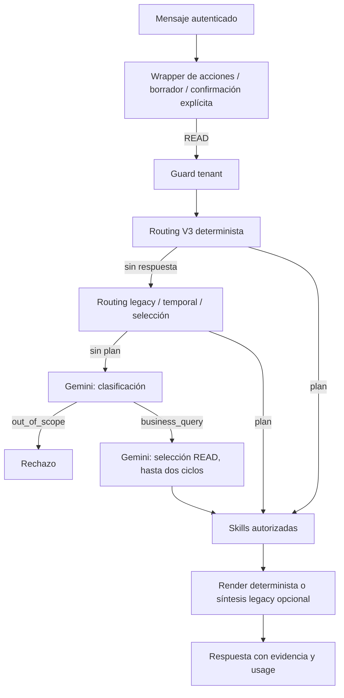

# M6.9J.1 — Auditoría LLM y diseño grounded

Fecha: 2026-10-15. Base inspeccionada: `433d6ab0d574f0aef7a7f1d13f907d7390538bab`.

## Resultado y alcance

**B. J.1 DETECTÓ GAP CRÍTICO PREVIO A DEEPSEEK.** La auditoría queda completada; integrar un proveedor de pago requiere primero una política de dominio/grounding explícita. No se identificó una ejecución WRITE por texto generado, ni se afirma una vulnerabilidad cross-tenant demostrada. El bloqueo es de routing, evidencia y control del gasto: consultas ajenas pueden llegar al clasificador pagado o al resolver de catálogo; el fallback de herramientas no expone las siete familias V3.

Solo se añadieron pruebas de caracterización y este documento. Sin cambios productivos, navegador, cloud, Mongo/Atlas, proveedores reales, entrenamiento ni secretos. Las respuestas y tokens del proveedor en los tests son ficticios. La configuración efectiva cloud, existencia/disponibilidad comercial del modelo por defecto y comportamiento generativo real quedan NO CONFIRMADOS. No se consultaron URLs, modelos ni precios DeepSeek; se verificarán oficialmente en J.2.

## 1. Arquitectura y configuración actuales

Proveedor único construido por producción: Gemini, SDK `@google/genai` fijado en `backend/package.json` a `2.27.0`.

| Archivo | Responsabilidad / evidencia |
|---|---|
| `backend/src/agents/providers/geminiProvider.js` | `createGeminiProvider`, singleton lazy `getGeminiProvider`, `generate`, `generateStructured`, `generateWithTools`, `forModel`; validación y normalización |
| `backend/src/config/env.js` | Default de modelo `gemini-3.8-flash`, timeout 15000 ms; valida configuración al inicio |
| `backend/.env.example` | Documenta variables; fallbacks de ejemplo `gemini-3.7-flash,gemini-3.6-flash`, no prueba configuración efectiva |
| `backend/src/agents/execution.js` | Construcción del proveedor, presupuestos, retries/failover, métricas e invocación |
| `backend/src/agents/contracts.js`, `definitions.js` | Límites globales y por agente |
| `backend/src/agents/routing.js` | Clasificador estructurado |
| `backend/src/agents/intentRouting.js`, `v3Routing.js` | Routing determinista legacy/V3 y contexto |
| `backend/src/agents/orchestrator.js` | Orden de ejecución y síntesis/fallback |
| `backend/src/agents/synthesis.js`, `responses.js` | Prompts, contexto compacto, evidencia, validación y render |
| `backend/src/agents/toolCalls.js` | Declaraciones READ permitidas; excluye deliberadamente V3 |
| `backend/src/automations/assistant.js` | Extracción opcional de campos de una acción; state machine separada |
| `backend/src/agents/observability.js` | Usage y eventos con whitelist |
| `backend/src/controllers/agentMessagesController.js`, `backend/src/services/agentConversationService.js` | Registro/proyección de respuesta e historial |
| `backend/src/controllers/agentSmokeController.js`, `backend/src/routes/agent.js` | Smoke explícito autenticado y rate-limited |

Variables relacionadas: `AGENT_ENABLED`, `GEMINI_API_KEY`, `GEMINI_MODEL`, `GEMINI_TIMEOUT_MS`, `GEMINI_FALLBACK_MODELS`. No existe selector productivo `LLM_PROVIDER`. No se leyeron ni imprimieron valores secretos ni archivos `.env` privados. Modelo efectivo local/cloud: NO CONFIRMADO; lo anterior describe defaults y código publicado.

El adapter no configura base URL ni versión: delega al SDK. La copia local instalada del SDK (`backend/node_modules/@google/genai/dist/node/index.cjs`, `ApiClient`) define por defecto `https://generativelanguage.googleapis.com/` y Google AI API `v1beta`. Es evidencia local de implementación, no verificación de disponibilidad externa. No hay transporte compatible con API estilo OpenAI reutilizado en estos puntos.

Temperatura: no configurada por la aplicación; default efectivo del proveedor NO CONFIRMADO. `thinkingLevel=low`, automatic function calling desactivado. Salidas estructuradas: MIME JSON + schema y validación local; herramientas: máximo cuatro calls por respuesta, dispatch manual bajo permisos del agente. Texto vacío, truncado, JSON malformado y schema inválido generan errores controlados. El clasificador solo acepta combinaciones coherentes de intent/agente/aclaración.

## 2. Mapa completo de puntos de llamada de la aplicación

La búsqueda de invocaciones en `backend/src`, `frontend/src` y `ml/service` encontró un transporte LLM: `getClient().models.generateContent` en `geminiProvider.js`. Los siguientes son los puntos lógicos que llegan a ese transporte; las dos síntesis son alternativas.

| Punto / función | Trigger | Input / output | Skills antes | WRITE, routing, OOD | Métricas |
|---|---|---|---|---|---|
| `routing.js::classifyAgentIntent`, desde `orchestrator.handle` | No hubo plan determinista/V3 | Pregunta, instrucción breve → `intent,targetAgent,requiresClarification` | No para clasificar la consulta inicial | Decide routing/OOD; sin ejecución WRITE | `execution` registra llamadas, tokens y latencia |
| `orchestrator.handle` → `execution.selectTools` | Clasificador devolvió business_query | Pregunta redactada (120 chars), periodo, SKU reciente y observaciones limitadas a 1600 chars → tools READ | Primera selección puede no tener datos; segunda usa resultados de búsqueda | Routing de tools; no WRITE; depende de clasificación OOD previa | Igual, por generación e intento |
| `orchestrator.handle` → `buildNarrativeSynthesisInput` | Plan `narrativeSynthesis` y resultados READY/NO_DATA | Pregunta redactada + evidencia compacta → 1–3 observaciones y hasta 2 limitaciones | Sí | Interpretación, no confirmación/ejecución; no clasifica OOD | Usage + estado/diagnóstico de síntesis |
| `orchestrator.handle` → `buildSynthesisInput` | Plan `synthesize` elegible | Agregados seleccionados → índices `sections` | Sí | Ordena texto calculado por Node; no prosa financiera libre ni WRITE | Igual |
| `automations/assistant.js::withActionAssistant.handle` → `execution.generateStructured` | Acción detectada, borrador inicial poco claro (`unclear`) | Campos explícitos de pregunta redactada → extracción validada | No necesariamente; resolución viene después | Puede contribuir al borrador/preview WRITE, nunca confirma por respuesta del LLM | Usage mediante execution; no cálculo monetario IA |
| `agentSmokeController.js::createGeminiSmokeHandler` | POST `/api/agent/smoke` habilitado, autenticado, cuerpo vacío, límite 3/min | Prompt fijo → `OK` | No | Sin routing/WRITE | Devuelve model/usage/latency directamente; fuera del agregado de execution |

`execution.generateStructured`, `generateWithTools` y los tres métodos del adapter son APIs internas, no puntos de red adicionales. No se identificaron invocaciones LLM en frontend ni en el serving Python inspeccionado.

La clasificación no genera una respuesta de conocimiento general: `out_of_scope` acaba en rechazo; `business_query` habilita selección READ y, sin tools suficientes, aclaración. Un proveedor puede clasificar mal: no hay gate determinista general de OOD antes del clasificador. Los regex que devuelven `null` en `routeV3` no son un rechazo final: continúan al routing legacy/proveedor.

## 3. OUT_OF_DOMAIN observado con código y dobles locales

Pruebas de conversación nueva V3 con contexto/autenticación ficticios. No afirman cómo respondería Gemini real.

| Pregunta exacta | Camino actual observado |
|---|---|
| ¿Quién ganó el partido ayer? | Sin plan determinista → clasificador simulado; `out_of_scope` → unsupported; 1 llamada lógica ficticia |
| ¿Cuál es la capital de Francia? | Igual |
| Cuéntame un cuento. | `routeV3` produce `lookup` de la frase completa: intentaría resolver producto, no rechazo OOD |
| ¿Qué laptop me recomiendas? | Sin plan → clasificador simulado |
| ¿Cuánto cuesta Bitcoin? | V3 null → legacy `product_details`, búsqueda `bitcoin`; no rechazo OOD |
| ¿Quién es el presidente de X? | Sin plan → clasificador simulado |
| ¿Cómo escribo un currículum? | Sin plan → clasificador simulado |

Para cuento/Bitcoin se caracterizó el plan de resolución, sin consultar un catálogo: respuesta final con datos reales NO CONFIRMADA. Si el clasificador simulado devuelve erróneamente `business_query` a geografía, se observa una segunda llamada de selección; sin tools pide aclaración. Un 401 simulado produce `AGENT_PROVIDER_FAILED`, tokens desconocidos `null`, sin skills. No es un rechazo OOD fiable independiente del proveedor.

La prueba H.7 `future-grounded and out-of-domain...` solo llama al router aislado y etiqueta los futuros casos; su contador local no conecta ningún proveedor. Es cobertura del arnés, no prueba de 0 tokens en el flujo productivo completo. J.1 hace explícita esa diferencia.

## 4. Preguntas de negocio cercanas al dominio

No deben rechazarse por ser abiertas. Actualmente el router V3 entrega estos planes, sin una política general de síntesis grounded:

| Pregunta | Plan actual caracterizado | Tratamiento futuro |
|---|---|---|
| ¿Cómo puedo mejorar mis ventas? | Business summary | Síntesis sobre ventas/margen y evidencia pertinente |
| ¿Qué debería priorizar en inventario? | **Business summary**, no Inventory | Corregir selección de familia antes de activar proveedor |
| ¿Qué clientes debería intentar retener? | Customer rank por spend, sin AT_RISK explícito | Retención: recency/actividad/riesgo con criterio explícito, no confundir con alto valor |
| ¿Qué significa WAPE en mi modelo? | Forecast evaluation, concepto wape | Mantener explicación determinista aprobada; interpretación abierta adicional puede ser grounded |
| ¿Por qué se eligieron 4 clusters? | Customer clustering, concepto kmeans | Reutilizar evidencia/metodología aprobada; no requerir LLM si basta explicación existente |
| ¿Qué conclusiones sacas de mis ventas? | Business summary | Síntesis sobre ese periodo, sin inferir causalidad |

`GROUNDED_LLM` es elegible para interpretación sustentada; no obliga a cobrar por definiciones y explicaciones ya deterministas. Las capacidades H.7 simples, selección de entidades/ordinales, stock/mínimo, ventas con periodo, forecast 1/7/14, métodos ML, listados, preview, confirmación y cancelación deben conservar 0 llamadas/0 tokens. No extender esa garantía a todo texto que contenga palabras del dominio.

## 5. Mapping de los 14 casos H.7 (diseño, no implementación)

Abreviaturas: B=`get_business_analytics`, I=`get_inventory_intelligence`, F=`get_product_forecast`, C=`get_customer_intelligence`, S=`get_supplier_intelligence`, M=`get_cross_sell_recommendations`, H=`get_business_health`. Son las siete skills existentes. Usar de 1 a 4 dispatches por turno, límite actual; reutilizar datos presentes, resolver entidades antes sin LLM.

| Pregunta H.7 | Skills necesarias | Contexto mínimo propuesto |
|---|---|---|
| Analiza ventas, inventario y forecast y dime qué debería priorizar. | B, I, F | KPIs/periodo, top 3 riesgos, forecast 7d de esos SKU |
| ¿Qué productos recomiendas reponer esta semana y por qué? | I, F; S si pide abastecimiento | should_reorder, stock/incoming/ROP y proyección, 3–5 SKU |
| ¿Qué productos tienen buen potencial pero riesgo de quiebre? | B rank, I, F | Ventas observadas + riesgo + forecast mismos SKU; no prometer potencial validado |
| ¿Qué estrategia recomendarías según mis ventas y margen? | B | Comparación/periodo, rankings, margen y disponibilidad de costo |
| Resume el estado del negocio como si se lo explicaras al dueño. | H | Componentes/alertas compactos y cortes; sin score global |
| ¿Qué clientes debería intentar retener primero? | C | Riesgo/recency/frequency/spend/trend, 3–5 códigos/labels autorizados |
| ¿Qué conclusiones importantes ves en mis datos? | H; B si hace falta detalle | 3 señales, comparación y limitaciones; aclarar alcance si no lo hay |
| ¿Qué debería mejorar primero? | H, I según señales | Alertas comparables y limitaciones; prioridad cualitativa justificada |
| ¿Qué decisiones tomarías para mañana? | H, I, F | Situación operativa, días cerrados hasta D−1, forecast 1d; recomendaciones sin ejecución |
| Según ventas, stock, forecast y proveedores, ¿qué debería comprar? | B, I, F, S | Mismos 3 SKU, cantidades del motor, incoming, proveedor/oferta disponible; máximo 4 skills |
| ¿Qué producto vende bien pero tiene poco stock? | B rank, I | Cruce por SKU estable, ventas del periodo y low_stock; no nuevo umbral |
| ¿Hay algo preocupante en mi negocio? | H | Alertas por dominio; atipicidad no significa fraude |
| ¿Qué productos nuevos debería comprar? | B category rank, M, I | Categorías/patrones existentes y huecos exploratorios; sin datos externos/SKU inventados |
| ¿Qué promoción convendría lanzar considerando margen y demanda? | B, F, M; I si necesario | Margen disponible, demanda y reglas congeladas; asociación sin causalidad ni uplift estimado |

Si el contexto exige más de cuatro skills, reducir alcance mediante aclaración o usar H ya compuesto. No saltarse el presupuesto ni concatenar llamadas LLM por dominio. Las cantidades de compra vienen del motor; la síntesis no crea órdenes. Esta tabla no acredita que los 14 textos ya ejecuten dichos planes hoy.

## 6. Context builder propuesto

Ampliar por dominio el patrón de `synthesis.js`; no enviar base/historial completo ni snapshots operativos crudos. Contrato propuesto: `{schemaVersion, query, scope:{scenarioId, mode, asOfDate, period, snapshotVersion}, evidence:[{ref, skillId, entity, facts, availability, limitations}]}`. BusinessId/tenant permanece en el contexto de autorización server-side, no se necesita exponerlo al proveedor. Separar LIVE, HISTORICAL y FROZEN; MA28 no recibe el día parcial, MBA conserva cutoff 2026-10-12.

Para explicar reposición de Pan Francés: solo nombre/SKU autorizado, stock, mínimo, cobertura, ventas recientes, forecast del horizonte solicitado, should_reorder, incoming y pedidos relevantes; incluir null/unavailable y procedencia. Sin lista de 80 productos, 40 clientes o tickets. Usar allowlists, top 3 por defecto/top 5 si procede y precisión existente. No correos/teléfonos/IDs Mongo, tokens, URI o documentos crudos. Texto de catálogo/pregunta se trata como datos no confiables, nunca instrucciones.

Reutilizar resultados dentro del turno bajo la misma revisión/snapshot; claves de memo incluyen tenant/scenario, periodo/cutoff, entidad, dataVersion/hash, versión de engine/artifact. No reutilizar autorización ni contexto entre tenants. En J.2 no es necesario agregar cache persistente de prosa LLM.

Gaps del builder actual: allowlists legacy no cubren todas las métricas V3; `compactFact` puede eliminar hechos por tamaño; truncar JSON con `.slice` en observaciones no garantiza un documento válido. Proyectar objetos antes de serializar y reportar cobertura incompleta. `dtoFieldCount` narrativo usa longitud serializada, no conteo real de campos: corregir nombre/cálculo en la implementación futura.

## 7. Límites, tokens y costo

Actual: 2000 caracteres de mensaje; prompt system hasta 2000, 1–8 mensajes de hasta 2000 cada uno y máximo combinado 6000 caracteres. Narrativa serializada hasta 2000 caracteres. Los targets declarados **no son medición ni hard caps de input tokens**.

| Agente | maxInputTokens declarado | responseTargetTokens | provider maxOutputTokens efectivo |
|---|---:|---:|---:|
| coordinator | 800 | 100 | 512 |
| operations | 1500 | 200 | 768 |
| analyst | 2200 | 450 | 1024 |

Global: máximo 3 generaciones lógicas, 4 skills y 2 ciclos de selección. SDK: un intento por solicitud; execution reintenta una vez tras 1000 ms solo timeout/network/500/502/503/504 y puede probar hasta dos modelos Gemini configurados, dentro de deadline 40000 ms y al menos 2000 ms útiles por intento. Hasta 4 intentos físicos por generación. 429 está marcado retryable en adapter pero execution NO lo reintenta ni hace failover; tampoco 401/403/404, JSON/schema/truncamiento/budget. El timeout configurado por intento es 1000–20000 ms, default 15000. No hay fallback automático a otra marca de proveedor.

Propuesta J.2, inicialmente configurable y conservadora: 1 generación grounded, cero retries de pago por defecto; 300–1200 tokens input como objetivo y 100–300 output normal. Detalle explícito puede autorizar un cap configurable mayor (p. ej. 600 output), con presupuesto total por request. Tamaños son política inicial, no tarifas ni garantía de tokenización: medir con tokenizer compatible verificado o estimador conservador marcado estimated antes de admitir la llamada; usage devuelto por proveedor es la medición real. Si excede contexto, reducir filas/campos conservando evidencia o aclarar, nunca truncar JSON ni borrar limitaciones silenciosamente.

Telemetría actual registra input/output/total/thought/cached/tool tokens oficiales, modelo solicitado/final, intentos, fallbacks, tiempos, chars/bytes, evidencia, participantes y estado/diagnóstico de síntesis. Campos desconocidos permanecen null; `metricsComplete=false`. `totalLlmCalls` cuenta generaciones lógicas, no intentos HTTP. Totales request usan el último resultado lógico, no suman automáticamente todo el posible costo de intentos; `providerGenerations.providerAttemptUsage` y `totalKnownUsage` preservan subtotales conocidos. Un subtotal no implica que intentos sin usage fueron gratis.

No existe cálculo de costo IA ni pricing config en los módulos inspeccionados; costo actual es **no calculado**, no $0 por defecto. Para determinista se sabe que no hubo llamadas: costo IA 0, pero el contrato actual no expone `provider=none`/`estimatedCost`.

Diseño aditivo: provider/model por generación/intento, `llmCalls`, `providerAttempts`, usage real, `usageAvailable`, `metricsComplete`, `providerLatencyMs`, `estimatedCost`, `costStatus`, `pricingVersion`. Pricing server-side por proveedor/modelo con precios input/output/cached opcional por millón, USD, effectiveFrom y fuente/versionado. Configuración futura de precios verificada oficialmente antes de activarla. Costo = suma de categorías facturables disjuntas por intento; no duplicar cached input ya incluido en input. Usage o tarifa ausente → null/unavailable; subtotal conocido separado. Determinista → none, model null, calls/tokens/cost 0. No registrar prompts o contexto sensible.

## 8. Abstracción e incorporación futura de DeepSeek

Ya hay inyección de `provider` y métodos estructurados/tools reutilizables. No basta cambiar una variable: `execution.js` importa Gemini, exige modelo Gemini configurado, mapea errores GEMINI, interpreta sus tokens y failover; validadores de observabilidad/controladores e historial conocen esos códigos. `toolCalls.js` construye declaraciones para Gemini y excluye V3. Reutilizar permisos, budgets y state machine; no crear segundo orquestador.

Cambio mínimo futuro: factory `agents/providers/index.js` con selector server-side `LLM_PROVIDER=gemini|deepseek`; adapter nuevo `deepseekProvider.js`; configuración propuesta `DEEPSEEK_API_KEY`, `DEEPSEEK_MODEL` y timeout/base URL solo server-side si el diseño verificado lo necesita. No leer selector, modelo, URL ni credenciales de argumentos del usuario. Defaults de compatibilidad Gemini permanecen hasta activación explícita. URL, modelo DeepSeek y compatibilidad exacta con API estilo OpenAI pendientes de documentación oficial, sin valores inventados.

Interfaz neutral: `generate({messages,maxTokens,temperature,metadata}) → {text,provider,model,usage:{inputTokens,outputTokens,totalTokens},latencyMs}`; conservar `generateStructured` como wrapper validado con schema neutral. Los campos vendor-specific opcionales no deben impedir `metricsComplete` cuando un proveedor no tiene thought/tool tokens. Normalizar errores provider-neutral conservando causa segura y compatibilidad con clientes/historial existentes. No exponer tools WRITE al sintetizador. Puede mantenerse tool selection legacy Gemini mientras la capa V3 grounded usa un plan READ determinista.

Archivos previstos en J.2: factory/adapter nuevos, `config/env.js`, `.env.example` sin secretos, `execution.js`, `observability.js`, contratos/proyección de historial, política de dominio y builder/síntesis, tests focales. Cambiar prompts/routing solo donde la auditoría demuestra el gap; no modificar motores ML/datasets.

## 9. Política objetivo y fallbacks

Orden: wrapper WRITE/guard de tenant → contexto/selección segura → rutas deterministas aprobadas → gate de dominio y plan de evidencia para intención analítica abierta → skills READ → builder → una síntesis validada. Rechazo local de OOD obvio (deportes, cuentos, geografía/actualidad externa, cotizaciones ajenas) considerando contexto: “laptop” puede ser producto real en otro catálogo; evitar blacklist global que bloquee entidades legítimas. Desconocido/ambiguo → aclaración local, no proveedor por defecto. Preguntas mixtas se limitan al componente sustentado y explican el alcance.

Errores actuales: clasificación/selección fallidas llegan al catch general y pueden terminar con mensaje de proveedor; no hay garantía general de conservar en la respuesta resultados parciales. Las ramas de síntesis sí conservan render/sections deterministas. En el diseño nuevo, si falla interpretación: mostrar hechos ya obtenidos y avisar que no pudo generarse la interpretación. Sin evidencia suficiente: no llamar; aclarar o indicar disponibilidad. Sin fallback pagado a otro proveedor y sin ejecutar WRITE.

WRITE se mantiene en `automations/assistant.js` y servicio transaccional: extracción validada → resolución bajo tenant → borrador/preview → confirmación explícita → ejecución. Selección ordinal/candidato o texto generativo nunca confirma. El LLM actual puede extraer campos de un borrador poco claro, lo que debe distinguirse de ejecución; se propone conservar la extracción determinista y aclaración para ambigüedades, sin cobro ni delegar seguridad. Los tests J.1 no invocan executor comercial.

Guard de alucinaciones futuro: instrucciones para usar exclusivamente evidencia, citar refs, declarar insuficiencia, separar hechos/recomendaciones, no fabricar cifras, productos externos ni causas; FP-Growth sin causalidad, Isolation Forest sin fraude/probabilidad, MA28 estadístico, HGB evaluado frente a aprobado por horizonte, WAPE no convertido a accuracy. Respuesta estructurada con refs y validador previo al render; cifras y entidades deben estar en **el contexto efectivamente enviado**, no solo en resultados completos retenidos en Node.

El validador narrativo actual coteja contra `results` completos y su regex de SKU cubre SKU/M5, no todos los identificadores V3 como PAN-FRE-001. Es insuficiente como guard general de la nueva capa V3; no se afirma que ya haya ocurrido una respuesta inventada. Ampliar validación por identidad real/evidencia enviada, disponibilidad temporal y afirmaciones metodológicas antes de habilitar síntesis V3.

Productos nuevos: recomendaciones exploratorias por categorías/patrones observados, siempre indicando que no hay historial directo de ese SKU ni predicción validada. No crear SKU/precios ni alegar tendencias externas no suministradas. Recomendación no se convierte en orden/precio/margen calculado.

## 10. Plan futuro pequeño, no ejecutado con proveedor real

| Familia | Casos | Selección y criterio |
|---|---:|---|
| DETERMINISTIC | 15 | Stock, mínimo, low_stock, should_reorder, ventas hoy/7d, forecast 1/7/14, ordinal válido/fuera de rango, WAPE, preview, cancelar, confirmación autorizada en mock: 0 LLM/0 tokens/$0 |
| GROUNDED | 18 | Los 14 H.7 + reposición de producto, retención con contexto, interpretación WAPE aplicada y comparación de cluster; 1 llamada cuando necesita síntesis, evidencia compacta, metodologías y nulls correctos |
| OUT_OF_DOMAIN | 10 | Siete H.7 + clima externo, consulta mixta negocio/deporte, instrucciones ajenas dentro de nombre de catálogo; rechazar OOD obvio sin LLM, preservar consulta legítima de catálogo, no tools improcedentes |
| FAILURE/FALLBACK | 5 | Timeout, 401, 429, 5xx, respuesta malformada: mocks sin saldo, sin WRITE, hechos preservados y costo desconocido explícito |

Antes del smoke real: API/modelo/precio oficiales verificados, presupuesto máximo total aprobado, guard de dominio activo, selector y telemetría probados. Primero 15+10 deterministas y fallos con mocks; luego 18 grounded reales como máximo con una llamada por caso sin repetir por presentación. Medir input/output/total/cached si aplica, costo estimado y latencia; separar intentos de generaciones. Mantener pruebas de no incremento en proveedor para selección, ordinales y confirmación; no LLM duplicado por skill/dominio. No recuperar ni reejecutar holdouts ML.

## 11. Validación J.1 y siguiente fase

Archivo nuevo `backend/test/llmRoutingAuditJ1.test.js`: 13 pruebas focales de caracterización. Cinco OOD en orquestador con clasificador inyectado; dos desvíos de resolver; clasificación business_query simulada; 401; guard tenant/ambigüedad saca; exclusión WRITE/V3 en tools; uso cero sin costo/provider field; seis preguntas cercanas con planes actuales. No es aprobación de esos comportamientos como diseño objetivo.

Primera corrida de 12: 10 PASS, 2 FAIL porque la hipótesis de que las siete OOD llegaban al clasificador era incorrecta. Se inspeccionaron los planes y se corrigieron las expectativas de caracterización para cuento/Bitcoin; producción no cambió. Corrida final: **13/13 PASS** con `node --test backend/test/llmRoutingAuditJ1.test.js`; `node --check` y `git diff --check`: **PASS**. No suites grandes ni pruebas reales del proveedor.

**J.2 recomendada:** cerrar primero gate de dominio, selección correcta Inventory/retención y contrato/builder V3 con pruebas; añadir factory neutral, métricas/costos versionados y adapter DeepSeek según documentación oficial. Activación de pago y smoke real limitados después de comprobar los guards. No basta sustituir Gemini por DeepSeek en el fallback actual. No continuar automáticamente ni hacer push desde J.1.
